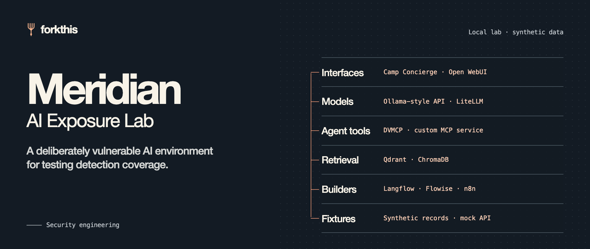

<h1 id="meridian-ai-exposure-lab"><picture><source media="(max-width: 650px)" srcset="docs/readme/cover-mobile.png"></picture></h1>

**Meridian is a deliberately vulnerable AI environment for security testing.** Its 13 local components include model APIs, agent tool servers, vector databases, workflow builders, and two chat interfaces. Use the lab to answer a practical question about a detection tool. Can it tell you which AI services are present, what each exposes, and what evidence supports the finding?

Meridian Outfitters is the fictional storefront for Camp Concierge, the lab’s custom assistant. The other services can be evaluated independently.

[See what’s in the lab](#the-vulnerable-ai-environment) · [Read a sample result](#how-to-read-a-result) · [Start the lab](#quick-start)

> [!WARNING]
> Run Meridian on an isolated machine. Keep all published services on loopback and off public tunnels. The lab includes deliberately vulnerable software, weak lab credentials, and synthetic customer records and keys.

## What it can do

- **Study an assistant’s trust boundaries.** Camp Concierge brings model instructions, synthetic customer information, and application tools into one conversation. Its fixtures let a reviewer distinguish the information a shopper should see from information the backend can reach.
- **Measure discovery.** Compare a scanner’s inventory with twelve Compose services and one host-side web proxy. See whether it recognizes both packaged AI products and custom services.
- **Measure the depth of a finding.** Separate evidence that a database exists from evidence that it exposes collections or documents. Make the same distinction for a model gateway’s access controls and an agent’s advertised tools.
- **Trace a report back to its source.** Seeded retrieval documents, dummy credentials, and planted web artifacts give you recognizable evidence without using real customer records.
- **Compare scanner versions.** Review two reports against the same inventory and fixtures. Track newly covered components, missed exposure types, and multiple findings that describe the same service.

## The vulnerable AI environment

| Components | What they let you evaluate |
| --- | --- |
| **Camp Concierge and the storefront proxy** | The custom assistant handles synthetic order lookups and simulated file access with weak boundaries around its instructions and data. The proxy and storefront provide a browser-facing route and planted client artifacts. A reviewer can assess custom chat discovery, browser access policy, and unintended disclosure separately. |
| **Ollama-style model API and LiteLLM** | The shim presents a recognizable model-serving interface. LiteLLM represents the gateway, with deliberately weak lab authentication. Together they let a tester score model discovery and gateway access control as separate findings. |
| **DVMCP and the custom MCP server** | Two implementations of the Model Context Protocol advertise tools to agents. Their catalogs cover data access, external requests, and administrative work. A report can identify those permissions from the catalog and describe the consequences of granting them. |
| **Qdrant and ChromaDB** | Two vector databases contain synthetic retrieval documents. They let a reviewer distinguish a database fingerprint, visibility into its collections, and access to records inside a collection. |
| **Langflow, Flowise, and n8n** | Langflow and Flowise are AI flow builders. n8n is a workflow automation service. They provide three management interfaces for testing product identification, visibility of API descriptions, and version reporting. |
| **Open WebUI** | A packaged model-facing chat interface gives the scanner a second point of comparison with the custom Camp Concierge application. |
| **Mock internal API** | Planted artifacts hold synthetic values in recognizable AI and cloud credential formats. A reviewer can check what the scanner identified and whether the report attributes it to the right source. |

[Open the two-page architecture and coverage diagram (PDF)](meridian-lab-diagram.pdf)

## Detection coverage

The diagram records seven detection families. These are examples of the evidence the documented scan reported.

| Detection family | Example from Meridian |
| --- | --- |
| Exposed AI products | The report identified Open WebUI, both flow builders, and the model-serving interface. |
| Weak or default credentials | The report recorded acceptance of a lab credential at the LiteLLM gateway. |
| Agent tool exposure | Both MCP servers exposed tool inventories. Reported tool descriptions included privileged capabilities. |
| Retrieval data exposure | The Qdrant finding identified the service. The ChromaDB finding specifically identified an open collections API. |
| Custom AI endpoints | The scanner found chat wiring in the Camp Concierge client and AI routes in API descriptions. |
| Leaked AI and cloud keys | The report identified synthetic key material in the mock API and artifacts served by the storefront. |
| AI API hygiene | The custom chatbot API allowed requests from any browser origin through its CORS policy. |

### How to read a result

Take the two retrieval findings. **Qdrant was identified. ChromaDB exposed a collections interface.** Credit both for discovery, and credit ChromaDB for the additional evidence about collection access. If the report makes a stronger claim about exposed customer records, look for evidence of a synthetic record before scoring it. The same principle applies to an MCP finding. Seeing an advertised tool establishes that a client can discover it. Execution is a separate question.

### Recorded baseline

| Comparison in the checked-in diagram | Reported findings |
| --- | ---: |
| Upstream scanner baseline | 5 |
| Compared scanner run | 55 |
| Critical / high findings in the compared run | 8 / 18 |

Those numbers describe one [recorded scanner comparison](meridian-lab-diagram.pdf) across 13 components. Several findings can describe different properties of the same component. The recorded exercise measured external exposure and did not perform interactive prompt injection, invoke agent tools, exploit CVEs, or validate keys with providers.

## Quick start

The repository supplies the test environment. Bring your own scanner if you want to generate a fresh report. You can also review the component map and recorded findings directly from this README.

### Requirements

- Docker Desktop, with room for about 6 GB of images on first pull
- Node.js 18 or later for the storefront proxy
- Optional host Ollama with `llama3.2:3b` for model-backed Camp Concierge responses

### Start

```bash
git clone https://github.com/jclark2496/meridian-ai-lab.git
cd meridian-ai-lab
./setup.sh
node lab/proxy/server.js
```

The setup script builds and starts the Compose services. The final command starts the storefront proxy. Open WebUI downloads its embedding model on first start. From a second terminal in the repository root, use `docker compose -f lab/docker-compose.yml ps` to check which services are running. Record that inventory alongside the report so a stopped service does not get counted as a missed detection.

### Stop

Stop the foreground proxy with Ctrl-C, then run this from the repository root.

```bash
docker compose -f lab/docker-compose.yml down
```

## One design decision

**Why include two chat interfaces?** A scanner can recognize Open WebUI by its product identity. Camp Concierge exposes the same broad category of functionality under a fictional retailer’s brand. Including both makes it possible to see whether a detector recognizes custom AI applications as well as familiar products.

## Project files

- [Architecture and coverage map](meridian-lab-diagram.pdf) — the inventory, representative findings, and scope of the recorded exercise.
- [Compose definition](lab/docker-compose.yml) and [local port reference](lab/STATUS.md) — the deployment inventory and local addresses.
- [Retrieval documents](lab/rag-seed/docs.json) and [Chroma seed](lab/chroma-seed/seed.py) — the synthetic records used by the retrieval fixtures.
- [Storefront](site/) — the fictional application in front of Camp Concierge.

[MIT License](LICENSE) · [Forkthis build notes](https://forkthis.ai/meridian/)
